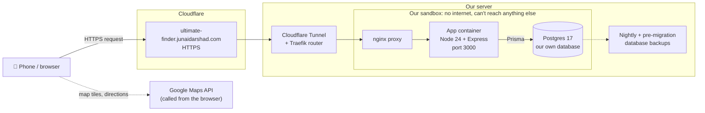
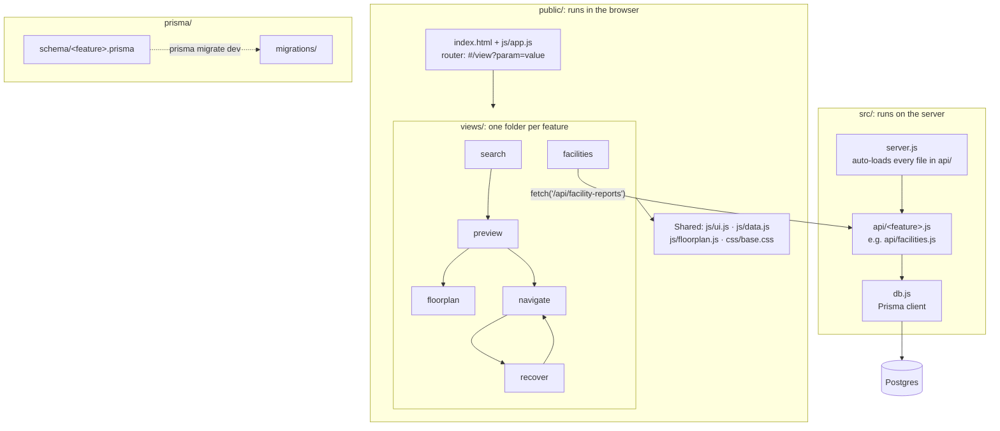
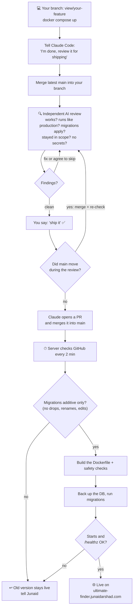

# Ultimate Finder: team kickoff

**Live:** <https://ultimate-finder.junaidarshad.com> ·
**Repo:** <https://github.com/maniic/Ultimate-Finder> ·
**How-to:** [`CONTRIBUTING.md`](../CONTRIBUTING.md)

We're turning our paper prototype (the interactive floor plan with photo
step cards) into a working web app:
- phone-first, built with plain HTML/CSS/JS on the frontend;
- a small Node server with a Postgres database;
- built mostly by vibecoding with Claude Code.

A clickable version of all six screens is already live, running on mock
OISE data. "Report a problem" in Facilities already saves to the real
database.

---

## 1. Features to assign

Each feature already works as a starting point. The top of its `view.js`
holds a `TODO` list taken from our think-aloud and heuristic evaluation.

| # | Feature | What's there now | What to build next | Owner |
|---|---|---|---|---|
| 1 | **Search** | Building name *or* code, autocomplete, "Did you mean…?" | Full U of T building list, browse all buildings, recent/saved rooms (HE4; needs the DB) | |
| 2 | **Route preview** | Walk time, entrance and floor, step-free switch | **Google Maps walking route to the right entrance**, clearer step-free explanation (think-aloud #2) | |
| 3 | **Floor plan** | Floor chips, highlighted room, route from elevator, legend | **Real floor plans** from the Floor-Plan Atlas PDF (image + tappable rooms), pinch-zoom | |
| 4 | **Step-by-step** | Step cards, progress, mini map, Previous/Next/Finish | **Real step photos**, read-aloud audio (HE1) | |
| 5 | **Recovery** | "This isn't what I see", blocked-elevator reroute, "Where are you?" | Better "I'm not sure" flow with landmark photos (**severity 3**, HE1/HE3) | |
| 6 | **Facilities** | Nearest by type, status, **report a problem (saved to DB)** | Make reports change the status, route to a facility, more buildings (think-aloud #4: testers' favourite) | |

**Shared work** (whoever's free, or split up):

| Task | Notes | Owner |
|---|---|---|
| **Real campus data**: buildings, rooms, entrances | Replace the mock data in `public/js/data.js`. It's a shared file, so agree on its shape first. | |
| **Photo walk**: OISE route to 10-210 + landmarks | On site; see the photo rules below | |
| **Google Maps key** | One person creates and restricts it | |
| **Usability test round 2** | Re-test the severity 3/2 findings on the live app | |

---

## 2. Architecture

### How a request reaches the app

- The page's HTML, JS and CSS travel back along the same path.
- **The database belongs to us alone.** It's separate from everything else
  on the server, and only our app can reach it.
- **The server can't reach the internet.** External APIs like Google Maps
  are called from the browser.

### How the code is organised

**Each feature owns its own files** (and the AI enforces it):

| Part | Your files |
|---|---|
| The screen | `public/views/<feature>/` |
| Server code | `src/api/<feature>.js` (loaded automatically) |
| Database tables | `prisma/schema/<feature>.prisma` + its migrations |

- **Everything else is shared,** and changing it needs your explicit OK when
  Claude asks.
- **Features talk only through the URL.** For example, search sends you to
  `#/preview?b=OI&r=10-210`, and you can open any screen directly by URL to
  test it.

---

## 3. CI/CD: from your laptop to the live site

| Step | Time |
|---|---|
| Merge → server notices | 0–2 min |
| Build + migrate + swap + health check | ~15–30 s (up to ~1 min if `package.json` changed) |
| **Total** | **Usually 1–2 min, at most ~2½** |

There's **no staging site.** `docker compose up` on your laptop is staging,
and it mirrors the server: same Node, same Postgres, same migrations.

---

## 4. Caveats, restrictions and nice-to-knows

### 🚨 The big ones
- **Merging = deploying.** Whatever lands on `main` is public within about
  2 minutes. Never push straight to `main`.
- **The repo is public.** Never commit passwords, API keys (except the
  restricted Maps key below), or anything about our study participants.
- **A broken deploy won't take the site down.** The server keeps the old
  version and your change just doesn't appear. If it's not live after
  ~5 min, tell Junaid: the error logs are on the server.

### 🗄️ Database rules
- **On your laptop, anything goes.** Experiment freely; `docker compose down -v`
  resets your local database.
- **On `main`, migrations may only add things. The server enforces it.**
  - **Allowed:** new tables, columns, indexes and enum values. (Seed data
    lives in repo files, not migrations.)
  - **Never:** dropping, renaming or retyping, or editing a migration
    that's already merged.
  - A merge that breaks this simply isn't deployed. Before shipping, your
    experiments get collapsed into one final migration (Claude does it).
  - Check with `sh scripts/check-migrations.sh --against origin/main`.
- **The database is for what users create** (reports, saved rooms). Campus
  data (buildings, rooms, routes) stays in the repo as files.
- **No personal data** (names, emails) without a group decision.
- **Local DB acting weird?** `docker compose down -v` wipes it, and the next
  `docker compose up` rebuilds it from the migrations.

### What the server can't do (by design)
- **No internet from the server.** Call external APIs from the browser.
- **No saving files.** The filesystem is read-only, so store data in the
  database.
- **No build step on the frontend.** Don't let the AI convert the project to
  React, Vite, Next.js, TypeScript and so on. That changes how the server
  builds it, so it's a group decision first.

### 🤖 Vibecoding tips
- **You need:**
  - Docker Desktop (or OrbStack on a Mac);
  - Git;
  - Claude Code;
  - the GitHub CLI (`gh auth login`);
  - **write access to the repo** (ask `maniic`).
- **Claude Code reads `CLAUDE.md` automatically.** It already knows the
  rules: your branch, your feature's files, the review, and never merging
  without your "ship it".
- **When Claude asks to change a shared file, actually think about it.**
  It'll explain what and why. Ask whether it can be done in your own
  folder instead. A "yes" to `base.css` changes everyone's screens.
- **Commit often** (or ask the AI to). Small commits are easy to undo, and
  one giant change isn't.
- **Don't add npm packages casually.** That's a shared change, so ask the
  group.
- **If the AI gets stuck in a loop or rewrites half the app:**
  `git checkout .` throws away uncommitted changes. Then start a fresh
  conversation with a smaller ask.
- **Test like a user:** phone-sized window (browser dev tools → device
  toolbar), keyboard only, and dark mode.

### 🗺️ Google Maps
- Works fine, but only **from the browser** (the Maps JavaScript API).
- One person creates the key in Google Cloud Console and **restricts it**:
  - HTTP referrers: `ultimate-finder.junaidarshad.com/*` and
    `localhost:3000/*`;
  - APIs: only the Maps APIs we use.
- Keep the key in `public/js/config.js`. A restricted key is safe to commit,
  and an unrestricted one is not.
- Set a budget alert on the Google Cloud project.

### 📸 Photos
- Put them in `public/img/<feature>/`, resized to about 1200 px wide and
  under ~300 KB.
- No identifiable faces. The repo is public.

### Small things that will confuse you otherwise
- **"My change isn't showing":** if you had the app open during a deploy,
  reload it.
- **After someone changes `package.json`,** run `docker compose up --build`.
- **All campus data is fake** (the OISE 10-210 scenario) and not checked on
  site. Don't present it as real in the final report.
- **Merge conflicts** almost always happen in shared files. Merge `main`
  into your branch often (`git merge origin/main`), and never use
  `--force`.
- **Something broke on the live site?** Open the merged PR on GitHub, click
  **Revert**, and merge the revert. The old version is back in about 2 min.

---

## 5. Leave the meeting with
- [ ] An owner for each of the six features (table above)
- [ ] Owners for the shared tasks: real data, photo walk, Maps key, test round
- [ ] Everyone added to the repo with write access (`maniic`)
- [ ] Everyone set up: Docker, Claude Code, `gh auth login`, and `docker compose up` working
- [ ] An agreed shape for the real campus data (or one person owns it)
- [ ] Next check-in date
